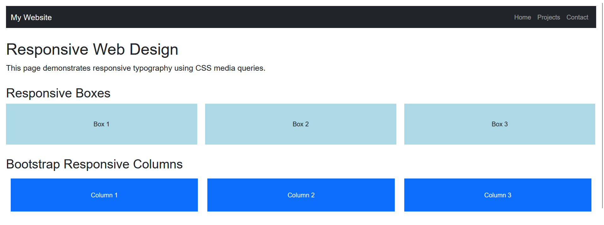
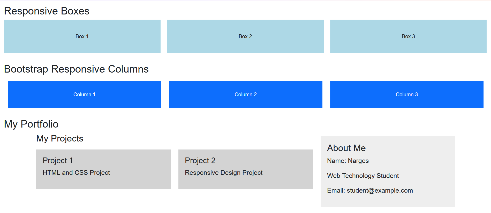
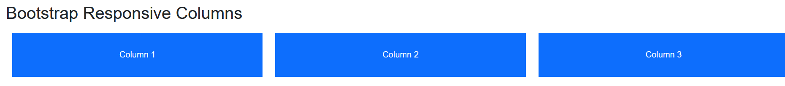
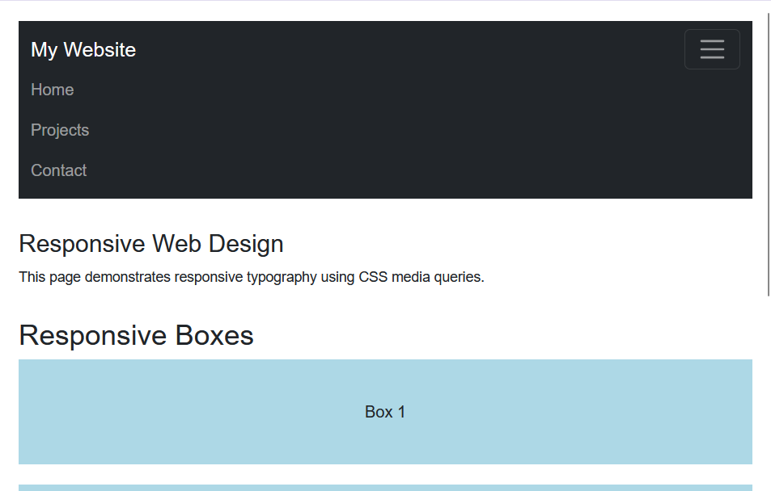
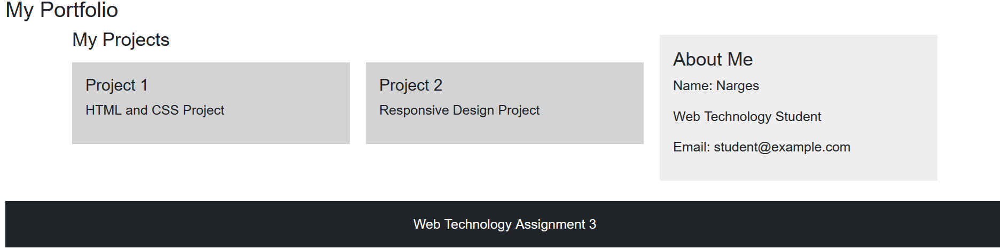

# Assignment 3 - Responsive Web Design

Name: Narges Jowkar 
Group: IT-2513

## Task 0 - Responsive Typography

In this task, I used CSS media queries to change the font size for different screen sizes.

## Task 1 - Responsive Layout with Media Queries

I created three boxes using Flexbox and CSS media queries. On desktop, three boxes are displayed in one row. On tablet, two boxes are displayed in one row. On mobile, the boxes are stacked vertically.

## Task 2 - Bootstrap Responsive Columns

I used the Bootstrap 12-column grid system. The columns use col-12 for mobile, col-md-6 for tablet, and col-lg-4 for desktop.

## Task 3 - Bootstrap Navigation Bar

I created a responsive Bootstrap navigation bar. On smaller screens, the navigation links collapse into a hamburger menu.

## Task 4 - Responsive Portfolio Page

I created a responsive portfolio section using Bootstrap Grid and CSS media queries. It contains a projects section, personal information, contact information, and a footer.

## Summary

In this assignment, I practiced responsive web design using CSS media queries and Bootstrap. I learned how to change layouts for mobile, tablet, and desktop screens and how to use the Bootstrap grid and responsive navbar.